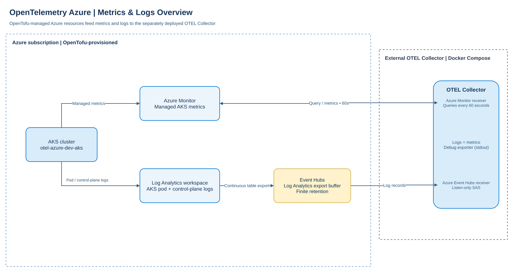

# OpenTelemetry Azure foundation

This OpenTofu root creates a resource group, a Log Analytics workspace, the
network prerequisites, an AKS cluster with a Spot worker pool, an Azure
Container Registry (ACR), and an Event Hubs destination for exported AKS logs.
The workspace and the Data Reader assignment for the identity running OpenTofu
are managed by the local `tf/modules/log-analytics` child module. AKS,
worker-pool, registry, and Event Hubs settings are managed by separate local
modules.

## Architecture overview

OpenTofu provisions the Azure-side resources. The OpenTelemetry Collector is
deployed separately with Docker Compose and runs outside the Azure subscription:

```text

    +-------------------->  +------------------+  ------------------------------------------+
    |         metrics       | Azure Monitor    |            AZ Monitor OTEL Receiver        |
    |                       +------------------+                                            |
    |                                                                                       |
    |                                                                                       v
+-------+                                                                            +------------------+
| AKS   |                                                                            | OTEL Collector   |
+-------+                                                                            +------------------+
    |                                                                                       ^
    |                                                                                       |
    |                                                                                       |
    +--------------------> +-------+  ------------->  +-------------+ ----------------------+
            pod / CP logs  | LAW   |    table export  | Event Hubs  |   AZ EH OTEL Receiver
                           +-------+                  | buffer      |
                                                      +-------------+
```

[](doc/diagrams/otel-azure-overview.png)

**Metrics:** AKS managed metrics are exposed through Azure Monitor. The
Collector's Azure Monitor receiver queries the configured subscription and
resource group every 60 seconds using the generated service principal. That
identity has subscription-level resource discovery access and **Monitoring
Reader** on the AKS resource group.

**Logs:** Container Insights collects pod/container logs and Kubernetes events
using the AKS-associated DCR/DCRA and writes them to Log Analytics. AKS
control-plane diagnostics are also sent to the workspace. The Event Hubs module
configures a continuous Log Analytics data export for the selected supported
tables. Event Hubs buffers the exported records so Collector availability is
decoupled from workspace export; its retention is finite, and export does not
backfill data from before the rule became active.

**Traces (reference architecture only):** Instrument AKS applications with an
OTLP SDK or auto-instrumentation and send traces to an in-cluster OTEL Collector
Service. That Collector can batch, enrich, and buffer telemetry before sending
it upstream to the external Collector over private connectivity, or over
TLS/mTLS with restricted ingress. This is documentation only: neither the
in-cluster Collector nor this traces flow is provisioned by Terraform or
included in the current OTEL configuration.

The external Collector consumes Event Hubs with a Listen-only SAS connection
and persists consumer checkpoints in its mounted storage. It also accepts OTLP
logs from clients. Although OTLP gRPC and HTTP endpoints are exposed, no traces
pipeline is configured. The included logs and metrics pipelines currently send
signals to the debug exporter (Collector stdout); add a production exporter to
forward them to a telemetry backend. The Collector deployment and configuration are documented in
[`apps/otel-collector`](apps/otel-collector/README.md).

## Layout

```text
.
├── apps/
│   ├── demo-app/
│   └── otel-collector/
└── tf/
    ├── dev/terraform.tfvars
    ├── modules/
    ├── scripts/az-infra.sh
    ├── main.tf
    ├── outputs.tf
    ├── providers.tf
    ├── variables.tf
    └── versions.tf
```

OpenTofu configuration lives in `tf/`. Run direct OpenTofu commands from the
repository root with `-chdir=tf`, as in the examples below.
Every root input has a default in `tf/variables.tf`; child modules take their
resource IDs and other required bindings as explicit inputs. `subscription_id`
defaults to `null`, allowing AzureRM to use the subscription selected by Azure
CLI or the AzureRM authentication environment. Set it in
`tf/dev/terraform.tfvars` to target a specific subscription.

## Configure and deploy

For a static Nginx sample running as a single replica on the AKS Spot worker
pool, see [`apps/demo-app/README.md`](apps/demo-app/README.md). It includes image build,
ACR push, deployment, and local port-forward instructions without creating a
Kubernetes Service.

From the repository root, sign in and select the subscription if needed:

```sh
az login
az account set --subscription "<subscription-id>"
```

The [`tf/scripts/az-infra.sh`](tf/scripts/az-infra.sh) helper accepts `-up` or
`-down`, plus optional `-auto` (GNU `getopt` also accepts the standard
double-dash forms). It uses the subscription in `tf/dev/terraform.tfvars` (or the
currently selected Azure CLI subscription if `subscription_id` is unset),
initializes OpenTofu, and authenticates through the Azure CLI. `-up` plans the
deployment and asks for confirmation before applying; `-down` runs the
interactive OpenTofu destroy flow. Add `-auto` to skip OpenTofu confirmation
prompts. Azure CLI authentication may still require interaction if there is
no active login:

```sh
./tf/scripts/az-infra.sh -up
./tf/scripts/az-infra.sh -down
./tf/scripts/az-infra.sh -up -auto
./tf/scripts/az-infra.sh -down -auto
```

Review and edit [`tf/dev/terraform.tfvars`](tf/dev/terraform.tfvars) to override the
development defaults. Initialize, format, validate, and inspect the plan before
applying:

```sh
tofu -chdir=tf init
tofu -chdir=tf fmt -recursive -check
tofu -chdir=tf validate
tofu -chdir=tf plan -var-file=dev/terraform.tfvars
tofu -chdir=tf apply -var-file=dev/terraform.tfvars
```

The workspace uses the `PerGB2018` pay-as-you-go SKU, 30-day retention, and a
1 GiB daily ingestion quota by default. Resource-level workspace access,
internet ingestion/query, and local authentication are enabled by default.
The AKS defaults use one Standard_D2s_v7 system node and one Standard_D2s_v7
Spot worker node. Spot VMs can be evicted and have no guaranteed capacity;
`spot_max_price = -1` permits paying up to the on-demand price.

Azure Monitor managed metrics and AKS logs to Log Analytics are each enabled
by default. When AKS and metrics are enabled, the
`tf/modules/otel-service-principal` module creates an Entra application, service
principal, and 12-month client secret.
The generated service principal object ID is passed to the AKS control-plane
module, which grants it the custom subscription-scoped resource-discovery
role and **Monitoring Reader** on the AKS resource group. Set
`enable_azure_monitor_metrics = false` to disable managed AKS metrics and omit
the OTEL service principal; disabling it after provisioning plans to destroy
the identity, secret, and associated role assignments. Set
`enable_azure_monitor_logs = false` to disable Container Insights, its DCR/DCRA
(including ContainerLogV2, KubeEvents, and KubePodInventory streams), and AKS
control-plane diagnostic logs to LAW. ContainerLogV2 collection is enabled
and includes all namespaces by default. Microsoft Defender for Containers is
disabled by default because it is a billable integration.

Creating the application/service principal and its client secret requires
Microsoft Entra permissions to register applications and manage credentials.
The Terraform state contains the generated client secret, so protect state and
limit access to it. Retrieve credentials for OTEL collector configuration with:

```sh
tofu -chdir=tf output -raw otel_service_principal_client_id
tofu -chdir=tf output -raw otel_service_principal_tenant_id
tofu -chdir=tf output -raw otel_service_principal_client_secret
```

The secret expires after 12 months and must be rotated before expiry. Creating
the custom subscription-level role and assignment also requires sufficient
subscription RBAC permissions.

The Event Hubs module is enabled by default. It creates a Standard namespace
with one throughput unit, an Event Hub with two partitions and one-day message
retention, a Listen-only SAS rule for the OTEL Collector, and a continuously
enabled LAW data export rule. The export rule targets the specific Event Hub
and includes supported AKS diagnostic and Container Insights tables. Initial
export-rule provisioning can take up to 30 minutes; new data is exported after
it becomes active, with no backfill of older LAW records. Set
`enable_event_hub = false` to omit the namespace, hub, SAS rule, and export
rule; doing so for managed resources plans their destruction.

Set `enable_aks = false` to omit the AKS network, control plane, and worker
pool while retaining the resource group and Log Analytics workspace. Set
`enable_aks_worker_pool = false` to retain AKS and its system pool but omit
the Spot pool. These flags use Terraform `count`; disabling a component that
is already managed plans to destroy it.

The Container Registry module is enabled by default and creates a Basic ACR
with a public endpoint and admin credentials disabled. Its name combines the
lowercase alphanumeric `container_registry_name_prefix` (default
`otelazuredevacr`) with an eight-character subscription ID suffix to provide a
globally unique name. When AKS is enabled, the AKS kubelet managed identity
receives the registry-scoped **AcrPull** role; no registry password is added to
the cluster. `enable_container_registry = false` disables the registry
independently of AKS. If AKS is disabled while ACR remains enabled, the
registry is still provisioned but has no AKS pull-role assignment. Destroying
or disabling ACR deletes the registry and its stored images.

## Build, push, and run an ACR image

From a directory containing a `Dockerfile`, build the image locally and push
it to the provisioned registry. The Azure CLI identity used to log in must
already have **AcrPush** (or equivalent write permissions) on this registry;
Terraform grants **AcrPull** to the AKS kubelet identity, not push access to
the interactive publisher.

```sh
ACR_NAME="$(tofu -chdir=tf output -raw container_registry_name)"
ACR_LOGIN_SERVER="$(tofu -chdir=tf output -raw container_registry_login_server)"
LOCAL_IMAGE="demo-app:dev"
ACR_IMAGE="${ACR_LOGIN_SERVER}/demo-app:dev"

docker build --tag "$LOCAL_IMAGE" .
az acr login --name "$ACR_NAME"
docker tag "$LOCAL_IMAGE" "$ACR_IMAGE"
docker push "$ACR_IMAGE"
```

Configure `kubectl` for the AKS cluster and create a Pod that uses the pushed
image. The kubelet managed identity pulls from ACR using the registry-scoped
**AcrPull** role; the Pod does not need an `imagePullSecret`.

```sh
az aks get-credentials \
  --subscription "$(tofu -chdir=tf output -raw subscription_id)" \
  --resource-group "$(tofu -chdir=tf output -raw resource_group_name)" \
  --name "$(tofu -chdir=tf output -raw kubernetes_cluster_name)"

ACR_LOGIN_SERVER="$(tofu -chdir=tf output -raw container_registry_login_server)"
kubectl apply -f - <<EOF
apiVersion: v1
kind: Pod
metadata:
  name: acr-demo
spec:
  containers:
    - name: demo-app
      image: ${ACR_LOGIN_SERVER}/demo-app:dev
      imagePullPolicy: Always
EOF

kubectl get pod acr-demo
kubectl logs acr-demo
```

The registry and AKS must both be enabled in the OpenTofu configuration for
the pull-role assignment to exist. After a new role assignment, allow time for
Azure RBAC changes to propagate if the first image pull fails.

The development API server allowlist includes `182.19.216.0/24`, carried over
from the existing AKS development configuration. Replace this with the current
operator egress CIDR before applying from another network. Add Microsoft Entra
admin group object IDs to `aks_admin_group_object_ids` to grant cluster-admin
access through Azure RBAC.

## Outputs and Log Analytics access

The root exports the subscription and resource group names, workspace
identifiers, Event Hubs namespace/hub names and ID, AKS cluster name and
resource ID, Kubernetes version, ACR ID, name and login server, the OTEL
service principal identifiers, and Spot worker pool name and ID:

```sh
tofu -chdir=tf output -raw subscription_id
tofu -chdir=tf output -raw resource_group_name
tofu -chdir=tf output -raw workspace_id
tofu -chdir=tf output -raw workspace_customer_id
tofu -chdir=tf output -raw workspace_name
tofu -chdir=tf output -raw container_registry_id
tofu -chdir=tf output -raw container_registry_name
tofu -chdir=tf output -raw container_registry_login_server
tofu -chdir=tf output -raw eventhub_namespace_name
tofu -chdir=tf output -raw eventhub_name
tofu -chdir=tf output -raw eventhub_resource_id
tofu -chdir=tf output -raw otel_service_principal_object_id
tofu -chdir=tf output -raw otel_service_principal_client_id
tofu -chdir=tf output -raw otel_service_principal_tenant_id
tofu -chdir=tf output -raw kubernetes_cluster_name
tofu -chdir=tf output -raw kubernetes_cluster_id
tofu -chdir=tf output -raw kubernetes_version
tofu -chdir=tf output -raw worker_node_pool_name
tofu -chdir=tf output -raw worker_node_pool_id
```

Use the login server output as the image prefix when tagging or deploying an
image, for example `<login-server>/<repository>:<tag>`. AKS can pull from this
registry through its kubelet identity when both AKS and ACR are enabled.

The OTEL Collector SAS connection string is sensitive. Retrieve it only when
needed and keep it secret; the consumer group is `$Default`:

```sh
tofu -chdir=tf output -raw eventhub_sas_connection_string
tofu -chdir=tf output -raw eventhub_consumer_group
```

The Log Analytics module assigns **Log Analytics Data Reader** on the workspace
to the identity running OpenTofu. Query the workspace with Azure CLI using its
customer ID:

```sh
WORKSPACE_ID="$(tofu -chdir=tf output -raw workspace_customer_id)"
az monitor log-analytics query \
  --workspace "$WORKSPACE_ID" \
  --analytics-query "print 1"
```

The AKS control-plane module grants the identity running OpenTofu the
**Azure Kubernetes Service Cluster User Role** (to fetch user credentials) and
**Azure Kubernetes Service RBAC Cluster Admin** (to authorize Kubernetes
operations) at the cluster scope. After role assignments propagate, connect
with the Azure CLI and verify kubectl access:

```sh
az aks get-credentials \
  --resource-group "$(tofu -chdir=tf output -raw resource_group_name)" \
  --name "$(tofu -chdir=tf output -raw kubernetes_cluster_name)"
kubectl get nodes
```

## State and cleanup

OpenTofu stores state locally by default. State contains Azure resource
metadata and must be protected; use an access-controlled, encrypted remote
backend for shared or production use.

The resource group and Log Analytics resources retain their existing addresses.
The network and AKS resources are added directly to this root; no AKS state
import or address migration is included. With an existing state, review the
plan to confirm it changes only intended settings and creates the intended
AKS resources before applying.

To remove resources managed by this root:

```sh
tofu -chdir=tf destroy -var-file=dev/terraform.tfvars
```
