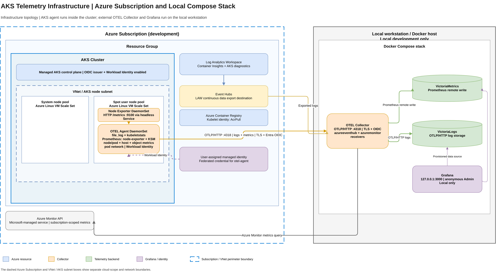

# Central OpenTelemetry Observability Architecture

This design centralizes AKS pod logs, kubelet, node-exporter, and
kube-state-metrics metrics, plus Azure Monitor platform metrics from
subscriptions across one or more Azure tenants in an Observability domain
outside Azure. Per-cluster agents send logs and metrics from `kubeletstats`,
node-exporter, and kube-state-metrics scrapes to the central OTLP endpoint at
`https://otel.cg5labs.net:4318` using AKS Workload Identity. The external
Collector independently reads Azure Monitor metrics using tenant-scoped service
principals and forwards logs to VictoriaLogs and metrics to VictoriaMetrics.

The configuration in this repository is a single-tenant, single-subscription
baseline. A multi-tenant rollout requires the additional tenant trust, identity,
RBAC, and Collector configuration described below; adding subscription IDs
alone is insufficient.

The diagram presents the deployed infrastructure: AKS and its node-local
`otel-agent` inside the Azure subscription and VNet/subnet boundaries, plus the
Docker Compose observability stack on the external local workstation.

[Editable infrastructure diagram](OTEL-ARCH.drawio) · [PNG diagram](OTEL-ARCH.png)

## Data flows

### AKS pod logs

1. The `otel-agent` DaemonSet reads container log files under `/var/log/pods`
   with the `file_log` receiver and enriches records with Kubernetes
   attributes.
2. Its logs pipeline exports OTLP/HTTP over TLS to
   `https://otel.cg5labs.net:4318`. The agent trusts the Collector server
   certificate using the CA mounted from the `otel-agent-mtls` Secret.
3. The Compose Collector's OTLP/HTTP receiver authenticates the Entra access
   token with OIDC. Its logs pipeline forwards accepted records to VictoriaLogs
   using OTLP/HTTP.

### AKS node, pod, and host metrics

The `otel-agent` DaemonSet uses the `kubeletstats` receiver to collect node and
pod metrics from the local kubelet. A Prometheus Community node-exporter
DaemonSet runs on the same user nodes using pod networking. A headless
`node-exporter` Service publishes the ready exporter pod IPs; the agent's
Prometheus receiver uses DNS service discovery to scrape each pod's
`/metrics` endpoint on port `9100` every 30 seconds. The agent and exporter
health probes target their respective pod IPs. A metrics transform replaces
dots in metric names with underscores and appends `_bytes` for metrics whose
unit is `By`. A `kube-state-metrics`
Deployment in the same namespace exposes Kubernetes object-state metrics on
its Service at port `8080`; the agent scrapes it every 30 seconds as well.
The agent's metrics pipeline exports all three sources as OTLP/HTTP over TLS to
the external Collector, reusing the agent's Workload Identity token and trusted
CA. The external Collector's OIDC-authenticated OTLP receiver feeds those
metrics into its Prometheus remote-write pipeline to VictoriaMetrics. Traces
are not enabled.

### Azure Monitor metrics

The external Collector's `azuremonitor` receiver queries AKS platform metrics
every 60 seconds using the external Collector service principal. Its metrics
pipeline sends samples to VictoriaMetrics through Prometheus remote write. This
external collection remains enabled independently of the AKS-managed Azure
Monitor metrics add-on, which is disabled in the dev OpenTofu configuration.

## Multi-tenant rollout requirements

Onboard each AKS cluster and each Azure subscription explicitly. Use a
tenant-local identity for each Azure tenant boundary; within one tenant, a
metrics service principal can be granted access to multiple subscriptions with
separate, least-privilege role assignments.

| Rollout scope | Requirements |
| --- | --- |
| Each AKS cluster sending logs, node/pod, and host metrics | Record tenant, subscription, cluster, and resource group. Enable the AKS OIDC issuer and Workload Identity webhook. Create a cluster-scoped UAMI and federated credential matching that cluster's issuer, `system:serviceaccount:otel-agent:otel-agent` subject, and `api://AzureADTokenExchange` audience. Install the agent with the Workload Identity pod label and service-account annotation; the `kubeletMetrics` chart preset grants `nodes/stats` access, and node-exporter metrics are available through a headless in-cluster Service. Install the pinned kube-state-metrics chart in `otel-agent` for cluster object metrics. Grant the identity the Collector API's `Telemetry.Write` role in the API's tenant, configure its scope and audience, trust the Collector server CA, and allow outbound DNS/TCP 4318. |
| Each subscription supplying metrics | Record the subscription ID and the resource groups containing target AKS resources. Grant the tenant's metrics SPN `Azure Monitor Metrics Resource Discovery Reader` at the subscription and `Monitoring Reader` on each target resource group. Include the subscription and resource-group scopes in the Collector receiver configuration, then verify resource discovery and metric reads. |
| Each Azure tenant | Provide a tenant-local metrics SPN, or an explicitly configured and consented multi-tenant application identity, for Azure Monitor access. Configure the central OTLP API trust and role assignment for agents from that tenant. The Collector must trust the intended token issuer and audience for every onboarded tenant. Keep each tenant's credential and RBAC boundary identifiable and independently revocable. |
| Central Observability domain | Publish the OTLP/HTTP endpoint, maintain its server certificate and trusted CA distribution, and provide controlled connectivity from each AKS network. Secure the Collector's tenant credentials and verify its outbound access to Azure Monitor and its configured VictoriaMetrics/VictoriaLogs endpoints. |

### Current multi-tenant boundary

The current Terraform API application is single-tenant (`AzureADMyOrg`), and
the Collector OIDC configuration contains one issuer and audience. The Compose
configuration also provides one Azure tenant, one metrics SPN, one subscription
ID, and one resource group, even though the receiver's subscription field is
list-shaped. Therefore, additional tenants require an intentional API trust
model (for example, tenant-specific API applications/service principals or a
consented multi-tenant application), corresponding `Telemetry.Write`
assignments, and matching OIDC issuer/audience configuration. The current OIDC
receiver validates issuer and audience; it does not enforce the
`Telemetry.Write` role claim itself. Establish and test the required
receiver-side authorization policy before accepting tokens from more tenants.

For multiple subscriptions in the same tenant, grant the tenant's SPN the
required roles on each subscription/resource group and configure the receiver
to query each intended scope. For subscriptions in different tenants, use a
tenant-specific Azure Monitor identity and receiver authentication
configuration for each tenant unless a cross-tenant application model has been
explicitly established and validated.

## Authentication and authorization

### Agent to external Collector

The agent uses a **user-assigned managed identity (UAMI) through AKS Workload
Identity**. It does not use a client secret or the AKS control-plane identity.

1. OpenTofu creates the UAMI and federates it to
   `system:serviceaccount:otel-agent:otel-agent`. The federated credential
   trusts the AKS OIDC issuer and the token-exchange audience
   `api://AzureADTokenExchange`.
2. The Helm release labels agent pods with
   `azure.workload.identity/use: "true"` and annotates the `otel-agent`
   service account with the UAMI client ID. The Workload Identity webhook
   projects the service-account token into the pod.
3. The agent's `azure_auth` extension exchanges that projected token for an
   Entra access token, requesting the Collector API scope from the
   `otel_otlp_scope` OpenTofu output.
4. The Collector API app exposes the `Telemetry.Write` application role and
   requires role assignment. OpenTofu assigns that role to the agent UAMI.
   The Collector's OIDC authenticator validates the token signature, issuer,
   and audience configured by `AZURE_TENANT_ID` and `OTEL_OIDC_AUDIENCE`.
   The Entra role assignment is the authorization grant; the receiver's OIDC
   configuration is responsible for token validation.

TLS and token authentication are separate controls: the agent verifies the
Collector certificate against its mounted CA, while OIDC validates the Entra
access token. Client-certificate authentication is not used.

### External Collector to Azure Monitor

The Collector runs on a Debian host outside Azure, so it does not use an Azure
managed identity. Its `azuremonitor` receiver uses a separate **service
principal (SPN)** through the Collector's `azureauth` extension. Compose
supplies the tenant ID, client ID, and client secret from the local environment.
This SPN authenticates the Collector to Azure Monitor; it is not the credential
used by the AKS agent to call the OTLP API.

OpenTofu grants the SPN:

| Scope | Role | Purpose |
| --- | --- | --- |
| Subscription | `Azure Monitor Metrics Resource Discovery Reader` | Read subscription resources for receiver discovery |
| AKS resource group | `Monitoring Reader` | Read AKS monitoring metrics |

The client secret is sensitive OpenTofu output and local Compose configuration.
Protect both the Terraform state and local `.env`; do not commit or include
secret values in documentation.

## Credential lifecycle considerations

The identity model removes static client credentials from AKS agent pods and
avoids maintaining an unrelated ingestion API key for every subscription. It
does not eliminate all credential rotation: the external Collector's current
Azure Monitor SPN uses a client secret.

| Method | Lifecycle and operational impact |
| --- | --- |
| AKS Workload Identity for OTLP ingestion | The pod exchanges its projected service-account token for short-lived Entra access tokens; no client private key or long-lived API key is stored in the DaemonSet. Revoke future access by removing the federated credential or `Telemetry.Write` assignment, or disabling the identity. The UAMI and federation still need lifecycle ownership, but token renewal is handled by the identity platform. |
| mTLS client certificates | Requires private-key distribution to agents, certificate issuance and renewal, CA trust and revocation management, and coordinated pod updates when credentials change. TLS remains enabled in this design to authenticate the Collector server; client-certificate authentication is disabled. |
| Individual API key per subscription | Creates static secrets to provision, protect, rotate, revoke, and track separately for each subscription. Key possession is not inherently tied to a tenant principal or Azure RBAC scope, and replacing a key requires updating every consumer that holds it. |
| SPN for Azure Monitor metrics | A tenant-local SPN can be authorized across multiple subscriptions using narrowly scoped Azure RBAC assignments, avoiding one credential per subscription. The current client secret still requires secure storage, expiry monitoring, and rotation; rotate or revoke it at the tenant identity boundary and remove the subscription-level role assignments independently. |

This separation provides per-cluster revocation for log ingestion and per-tenant
credential management with per-subscription authorization for metrics. The
Collector server certificate and CA continue to have their own renewal
lifecycle; they protect transport and do not replace Entra authentication.

## Configuration references

| Component | Source |
| --- | --- |
| Agent log/metrics pipelines, Workload Identity extension, CA mount, and user-pool selection | [Helm values](../tf/helm/otel-collector-agent-values.yaml) |
| Service-account annotation, endpoint, and deployment wiring | [Agent deployment script](../tf/scripts/otel-agent.sh) |
| UAMI, federated credential, Collector API app role, and role assignment | [OpenTofu root](../tf/main.tf) |
| Azure Monitor SPN permissions | [AKS control-plane module](../tf/modules/aks-control-plane/main.tf) |
| AKS-managed metrics add-on and external Collector metrics-reader toggle | [OpenTofu variables](../tf/variables.tf) |
| External Collector SPN and client secret | [OTEL service-principal module](../tf/modules/otel-service-principal/main.tf) |
| Identity, audience, issuer, scope, and SPN outputs | [OpenTofu outputs](../tf/outputs.tf) |
| OTLP TLS/OIDC receiver, Azure Monitor receiver, and Victoria exporters | [External Collector config](../apps/otel-collector/otel-collector.yaml) |
| External Collector environment, certificates, and published OTLP ports | [Compose service](../apps/otel-collector/compose.yaml) |
